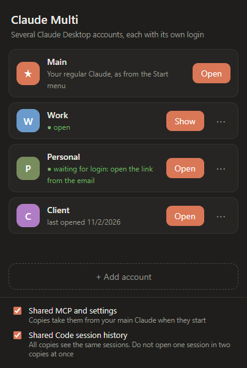

# Claude Multi: run multiple Claude Desktop accounts at the same time on Windows

**English** | [Русский: мультиаккаунт Claude Desktop](README.ru.md) | [简体中文：Claude Desktop 多开、多账号](README.zh-CN.md)

Claude Multi is a free, open-source launcher that opens several accounts of the **real Claude Desktop app** side by side on Windows, with no logging out and no web wrapper. Each window is the full app with its own login, including Claude Code and MCP, and email sign-in links open in the window that asked for them, not in your main Claude.

<p align="center"></p>

> Unofficial community project. Not affiliated with, endorsed by, or supported by Anthropic. "Claude" is a trademark of Anthropic. You are responsible for following the [terms](https://www.anthropic.com/legal/consumer-terms) that apply to your accounts.

## Is this the right tool?

**Use it if** you are on Windows with the Microsoft Store version of Claude Desktop and want to:

- keep a work and a personal Claude account open at the same time;
- work on one project folder from different accounts;
- share MCP servers, settings and Claude Code history between accounts;
- stop the email sign-in link from opening in the wrong Claude window.

**Look elsewhere if** you need:

- **macOS:** this launcher is Windows only. See [claude-multiprofile](https://github.com/jmdarre-v/claude-multiprofile).
- **Fully isolated accounts:** the sharing options are on by default. You can turn them off, but a tool built around isolation may suit you better.
- **Claude Code in the terminal only:** you do not need a desktop launcher for that.

## Features

- **Separate logins.** Each copy of Claude Desktop keeps its own session, so accounts stay signed in at the same time.
- **Email login goes to the right copy.** The sign-in link from the email opens in the copy that is waiting for it, not in your main Claude.
- **One workspace.** Open the same project folder from different accounts.
- **Shared settings and MCP.** Each copy takes MCP servers and settings from your main Claude when it starts. You can turn this off.
- **Shared Claude Code history.** All copies see the same Code sessions. You can turn this off.
- **Warns when one chat is open in two copies.** The launcher names the chat and the copies, so the history does not split unnoticed.
- **Desktop shortcuts** for each account.
- **English, Russian and Simplified Chinese interface.** The launcher follows your Windows language.
- **Your main Claude stays as it is.** It keeps working as usual, and its data is only read or shared if you leave the sharing options on.

## Compared with similar tools

Other free tools solve parts of the same problem on Windows. This table only repeats what each project's README said on 5 November 2026; check the links for the current state, and [open an issue](https://github.com/Markwork51020/claude-desktop-multi-account/issues) if something here is wrong.

| | Accounts open at the same time | Email or browser sign-in reaches the right window | Shared MCP, settings and Code history | Interface |
| --- | --- | --- | --- | --- |
| **Claude Multi** | Yes | Yes, on by default | Yes, each can be turned off | Window app |
| [Claude Profile Switcher](https://github.com/PriyanshuGeTRekT/Claude-Code-Desktop-Switcher) | Yes | Yes, optional | Moves Code chats between accounts | Window app (PowerShell) |
| [claude-desktop-multi](https://github.com/sypnose-cloud/claude-desktop-multi) | Yes | No: sign in to each new copy with the others closed | No, each copy is separate | Script and shortcuts |
| [Claude / Codex Multi-Instance](https://github.com/Zoltak-Dev/ai-multi-instance) | Yes, Codex too | Yes, through a temporary swap of your main Claude data | No, profiles are separate | Terminal menu (Python) |
| [Claude Account Switcher](https://github.com/SnlperStripes/claude-account-switcher) | No: switches one Claude between accounts | Not needed: keeps a saved sign-in per account | Carries Code chats across | Tray app, Windows and macOS |

**In short:** Claude Multi suits you if you want several accounts open at once that work on the same projects with the same MCP servers. If you want accounts kept fully apart, one of the other tools may fit better.

## Security and privacy

Claude Multi is a small launcher, and you can check every claim below in the source: [main.js](https://github.com/Markwork51020/claude-desktop-multi-account/blob/main/main.js), [lib.js](https://github.com/Markwork51020/claude-desktop-multi-account/blob/main/lib.js), [preload.js](https://github.com/Markwork51020/claude-desktop-multi-account/blob/main/preload.js).

- **No network code.** The launcher makes no connections of its own: no telemetry, no update checks, no server.
- **Never touches your sign-in.** It does not read, copy or move cookies, tokens or passwords. Each copy of Claude signs in by itself, and its login stays in its own folder.
- **Reads process information only to show status.** Every few seconds it lists running Claude processes to see which copies are open and whether a chat is open twice, and reads chat titles from the session files. This stays on your computer and is not saved.
- **Does not change Claude Desktop.** No patching, no injected code, no proxy. It only starts the official app from the Microsoft Store.
- **No administrator rights.** The registry is written only under your own user (`HKCU`), to receive `claude://` links. [Uninstall](#uninstall) lists every key.
- **No third-party packages at run time.** Only Electron and Node.js built-in modules.
- **Not a sandbox.** Copies run with your Windows user rights, like Claude itself. With sharing on, your MCP config, including any secrets in it, is copied into each profile on your computer.

## Install

**Requirements:** Windows 10 or 11, and [Claude Desktop](https://claude.ai/download) from the Microsoft Store.

In PowerShell:

```powershell
curl.exe -L -o "$env:TEMP\ClaudeMulti.zip" https://github.com/Markwork51020/claude-desktop-multi-account/releases/latest/download/ClaudeMulti-win32-x64.zip
```

```powershell
Expand-Archive "$env:TEMP\ClaudeMulti.zip" "$env:LOCALAPPDATA\Programs" -Force
```

```powershell
Start-Process "$env:LOCALAPPDATA\Programs\ClaudeMulti-win32-x64\ClaudeMulti.exe"
```

Or download the zip from [Releases](https://github.com/Markwork51020/claude-desktop-multi-account/releases/latest), unpack it and run `ClaudeMulti.exe`.

The build is not code-signed, so Windows SmartScreen may warn you: choose **More info → Run anyway**, or [build it from source](#build-from-source). Each release lists the zip's SHA-256.

## Add an account

1. Click **+ Add account** and enter a name. A separate Claude window opens with an empty login.
2. Sign in with your email and open the link from the message.
3. The first time, Windows asks which app should open the link. Choose **Claude Multi** and tick **Always use this app**.

The link goes to the copy you opened most recently that is still waiting for a login. To sign in to an existing copy again, use **⋯ → Sign in again** first.

## FAQ

### Can Claude Desktop use two accounts at once?

Not by itself. The app signs in to one account at a time, and switching normally means logging out. Claude Multi gets around this by starting a separate copy of the official app for each account.

### How do I run two Claude Desktop instances on Windows?

Start the app with a different `--user-data-dir` for each instance:

```powershell
& "$env:LOCALAPPDATA\Microsoft\WindowsApps\claude-desktop.exe" --user-data-dir="$env:USERPROFILE\.claude-work"
```

This is what Claude Multi does under the hood. A shortcut alone is enough to get a second window, but it leaves you with the sign-in problem below.

### Why does the Claude email login link open the wrong account?

The link uses the `claude://` protocol, and Windows hands that to your main Claude, so a second instance never receives it. Claude Multi registers as a handler for these links and passes each one to the copy that is waiting for a login.

### Shortcut or Claude Multi?

| | Shortcut with `--user-data-dir` | Claude Multi |
| --- | --- | --- |
| Second window with its own data | Yes | Yes |
| Email link opens in the right window | No | Yes |
| List of accounts | No | Yes |
| Shared MCP and settings | Manual | Built in, optional |
| Shared Claude Code history | Manual | Built in, optional |

### Does Claude Code work in every copy?

Yes. Each copy is the full desktop app, so its Code tab runs under that copy's account. All copies can work in the same folder.

### Is this a sandbox?

No. Each copy is the same app using a different data folder. Logins and app data are separate, but every copy runs with your Windows user rights and can reach the same files. Do not treat it as a security boundary.

### Does it work with the Microsoft Store version?

Yes, and for now that is the only version it supports. Data is kept in `%USERPROFILE%\.claude-multi` so that it stays outside the Store app's virtualized AppData folder.

### What language is the interface in?

The launcher follows your Windows language: English, Russian or Simplified Chinese, and English for anything else. Claude Desktop's own language is not affected.

### Does it give access to Claude in unsupported regions?

No. It provides no accounts, network connection or access to Claude, and it does not get around regional restrictions. It only starts the official app you already installed. Check Anthropic's [supported countries and regions](https://www.anthropic.com/supported-countries).

### Does it modify Claude Desktop or send my data anywhere?

No. See [How it works](#how-it-works).

### Is it allowed?

That depends on your plan and how you use it. Anthropic's terms apply to each account, and this project cannot answer that for you. Please read them, especially if you plan to use extra accounts to get around usage limits.

## How it works

Claude Multi starts the official app with its own `--user-data-dir` for each account, which gives every copy its own login and data. It does not patch or modify Claude Desktop and has no server of its own. Sign-in links are passed straight to the copy and are never saved or logged. With shared settings on, the MCP config, including any secrets you keep in it, is copied into each profile on your computer.

| What | Where |
| --- | --- |
| Accounts and profiles | `%USERPROFILE%\.claude-multi` |
| Link handler (current user only) | `HKCU\Software\Classes\ClaudeMulti.Link`, `HKCU\Software\ClaudeMulti` |
| App registration (current user only) | `Claude Multi` value in `HKCU\Software\RegisteredApplications` |

Shared history is a directory junction from each copy's session folder to the main one.

## Limitations

- **Early release.** So far it has been tested on one machine: Windows 10 with the Microsoft Store build. If a link lands in the wrong window, please [open an issue](https://github.com/Markwork51020/claude-desktop-multi-account/issues).
- **Windows only**, and only the Microsoft Store version of Claude Desktop for now.
- **Do not open the same Code session in two copies at once.** They write to the same file, and each window keeps showing its own version, so one falls behind and the history can split. The launcher warns you when this happens. Switching to another chat does not fix it, because Claude keeps that chat running in the background: fully quit one copy (Claude icon in the tray, then Quit) and open it again.
- **Connector sign-ins.** OAuth callbacks for MCP connectors started in a copy go to your main Claude.
- **Google and SSO sign-in** links are routed the same way, but have not been tested.
- **Cowork.** Other users of `--user-data-dir` setups report that only one profile can run Cowork at a time. This has not been tested here.
- **Claude Desktop updates can break this.** The launcher relies on how the app behaves today, not on a supported API.

## Uninstall

1. Delete the app folder. Remove `%USERPROFILE%\.claude-multi` if you also want to delete the copies' logins and data.
2. Remove the registry entries:

```bash
reg delete "HKCU\Software\Classes\ClaudeMulti.Link" /f
```

```bash
reg delete "HKCU\Software\ClaudeMulti" /f
```

```bash
reg delete "HKCU\Software\RegisteredApplications" /v "Claude Multi" /f
```

## Build from source

```bash
npm install
```

```bash
npm run build
```

The result is in `dist\ClaudeMulti-win32-x64`. Link routing only works in the packaged build, not with `npm start`.

## License

[MIT](LICENSE)
